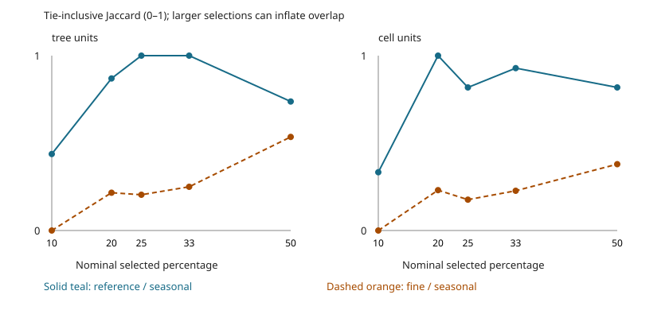
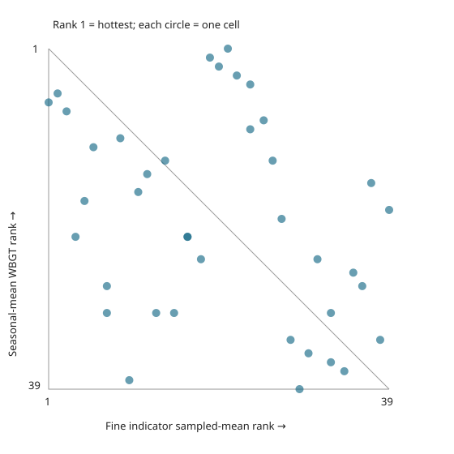

# Offline heat-support diagnostics

Generated from committed summaries only. Operational ranking and stakeholder decisions are unchanged.

## Findings

- Same-archive reference-day versus seasonal-mean ranks have cell-level Spearman 0.918 and exact top-cell overlap 9/10. This is agreement among pooled summaries, not held-out summer validation.
- Only 2.641% of the fine indicator's equal-cell-weighted variance lies within sampled cells. The observed point sample therefore does not support within-cell variance dominating total variation. It does not measure all within-cell surfaces or identify the cause of cross-product disagreement.
- Fine indicator versus seasonal archive ranks have cell-level Spearman 0.337 after aggregation: product disagreement remains. The district exclusions below show how sample-dependent that association is.

## Method and interpretation

100 convenience-sampled trees occupy 39 archive cells. Each cell receives equal weight in cell-level comparisons. The fine-layer cell statistic is the mean **at sampled tree points**, not an area mean or a representative cell estimate.

The detailed Brussels Environment layer is a source-normalized 0–100 indicator for a 24-hour mean on 24 August 2016, with 2 m radiation/shade modeling. VITO's archive is 100 m daily-maximum WBGT in °C. Same model family does not mean matching spatial support. Cross-product differences cannot isolate time, shade, normalization or model error.

Sources: [Brussels Environment detailed-layer methodology](https://environnement.brussels/citoyen/documentation-et-outils/etat-des-lieux-de-lenvironnement/ilot-de-chaleur); [VITO archive](https://provide.marvin.vito.be/ftp/compressed_daily/). VITO daily-archive reuse terms remain unresolved: the archive page states none, the NetCDF files carry no licence attribute, and neither the CC BY 4.0 Souverijns et al. (2026) decadal set nor the CC-BY-4.0 Copernicus CDS record sis-urban-climate-cities (hourly temperature, humidity and wind for 100 cities, no WBGT, deprecated on the CDS 2024-05-10) licenses this daily WBGT archive. See docs/heat-season-method.md, section 'Licence and lineage'. This is internal exploratory analysis, not a redistribution clearance.

Published numeric diagnostics are rounded to 12 decimal places for cross-runtime reproducibility; selection uses the unrounded calculations. Ranks use average ranks for exact ties in the committed rounded values. Exact top-k uses ID tie-breaking; inclusive top-k retains every cutoff tie. Jaccard = inclusive intersection / inclusive union. Tree k=10; cell k=10 (ceiling of one quarter of cells). These are different selection policies, not a controlled estimate of aggregation's effect.

## Fine indicator versus archive

| Archive metric | Tree Spearman | Cell Spearman | Cell inclusive Jaccard | Cells in exact tree top ten |
|---|---:|---:|---:|---:|
| reference_date_wbgt_c | 0.565 | 0.499 | 0.25 | 3 |
| seasonal_mean_wbgt_c | 0.408 | 0.337 | 0.176 | 3 |
| seasonal_p90_wbgt_c | 0.313 | 0.257 | 0.176 | 3 |
| hot_days_per_season | 0.311 | 0.255 | 0.176 | 3 |

## Same-series temporal comparison

All rows compare aggregations of the same VITO daily-maximum series against the same reference day, so the period is the only thing that changes. Exact overlap is out of the same k, with ID tie-breaking; tie-inclusive sets can be larger.

| Archive metric | Unit | Exact overlap | Tie-inclusive set sizes | Inclusive overlap | Jaccard | Spearman |
|---|---|---:|---:|---:|---:|---:|
| seasonal_mean_wbgt_c | tree | 7/10 | 11, 12 | 7 | 0.438 | 0.922 |
| seasonal_mean_wbgt_c | cell | 9/10 | 10, 10 | 9 | 0.818 | 0.918 |
| seasonal_p90_wbgt_c | tree | 7/10 | 11, 12 | 7 | 0.438 | 0.841 |
| seasonal_p90_wbgt_c | cell | 9/10 | 10, 10 | 9 | 0.818 | 0.839 |
| hot_days_per_season | tree | 7/10 | 11, 12 | 7 | 0.438 | 0.862 |
| hot_days_per_season | cell | 9/10 | 10, 10 | 9 | 0.818 | 0.875 |

## Within-cell variation

Population variance is partitioned into within-cell and between-cell components using the sampled indicator values, in indicator-squared units. It is not a causal effect or a random-effects estimate. 13 cells contain only one sampled tree and contribute zero observed within-cell variance by construction; this does not establish spatial uniformity.

| Weighting | Within | Between | Within fraction |
|---|---:|---:|---:|
| variance_tree_weighted | 3.344 | 85.958 | 0.037 |
| variance_equal_cell | 2.333 | 86.016 | 0.026 |

## Leave-one-district-out sensitivity

Recompute sampled cell means after excluding each district. This checks dependence on sample composition; it is not a confidence interval or out-of-sample validation.

| Omitted district | Retained trees | Cells | Fine versus seasonal-mean Spearman |
|---|---:|---:|---:|
| BEGUINAGE - DIXMUDE | 85 | 34 | 0.461 |
| HEEMBEEK | 98 | 38 | 0.396 |
| HEYSEL | 99 | 38 | 0.306 |
| QUARTIER EUROPEEN | 95 | 37 | 0.341 |
| QUARTIER ROYAL | 67 | 27 | -0.138 |
| SQUARES | 65 | 24 | 0.546 |
| STALINGRAD | 91 | 36 | 0.231 |

## Offline robustness stress tests

These fixed sensitivity scenarios are not confidence intervals, measurement-error bounds, or a search for the best-looking cutoff. No scenario changes the operational score.

### Selection fractions

Use the same nominal fraction within each analysis unit: k = ceiling(n × percentage / 100). Ties can expand the selected sets beyond k; L/R sizes below count the two inclusive sets. Equal fractions do not make trees and cells equivalent populations. Larger selections often overlap more mechanically, which does not establish validity.

| Unit | Nominal % | k / n | Temporal L/R sizes | Temporal Jaccard | Fine/seasonal L/R sizes | Fine/seasonal Jaccard |
|---|---:|---:|---:|---:|---:|---:|
| tree | 10 | 10 / 100 | 11/12 | 0.438 | 10/12 | 0.0 |
| tree | 20 | 20 / 100 | 20/23 | 0.87 | 22/23 | 0.216 |
| tree | 25 | 25 / 100 | 27/27 | 1.0 | 26/27 | 0.205 |
| tree | 33 | 33 / 100 | 33/33 | 1.0 | 37/33 | 0.25 |
| tree | 50 | 50 / 100 | 55/51 | 0.738 | 58/51 | 0.535 |
| cell | 10 | 4 / 39 | 4/4 | 0.333 | 4/4 | 0.0 |
| cell | 20 | 8 / 39 | 8/8 | 1.0 | 8/8 | 0.231 |
| cell | 25 | 10 / 39 | 10/10 | 0.818 | 10/10 | 0.176 |
| cell | 33 | 13 / 39 | 13/14 | 0.929 | 13/14 | 0.227 |
| cell | 50 | 20 / 39 | 20/20 | 0.818 | 20/20 | 0.379 |

Two panels keep tree and cell populations separate. X = nominal selected percentage; Y = tie-inclusive Jaccard. Solid teal compares reference-day with seasonal-mean archive WBGT; dashed orange compares the fine indicator with seasonal-mean archive WBGT. Markers are the tested thresholds, not interpolated evidence. Tooltips include k, n and tie-expanded sizes. All observations are present; no confidence bands are implied.

### Archive-temperature coarsening (cells only)

Round both reference-day and seasonal-mean WBGT from the committed two decimals to one decimal or whole degrees Celsius (nearest, ties-to-even). Keep the fine indicator unchanged. One value per cell preserves shared observations. This tests deliberate coarsening only: it cannot recover unrounded data or bound hidden rounding error. A high inclusive Jaccard can result from tie expansion rather than robust discrimination. Spearman is undefined for a constant input.

| Decimals | Distinct reference/seasonal | Temporal L/R sizes | Temporal Jaccard | Temporal Spearman | Fine/seasonal L/R sizes | Fine/seasonal Jaccard | Fine/seasonal Spearman |
|---|---:|---:|---:|---:|---:|---:|---:|
| 2 | 32/30 | 10/10 | 0.818 | 0.918 | 10/10 | 0.176 | 0.337 |
| 1 | 10/11 | 11/11 | 1.0 | 0.894 | 10/11 | 0.235 | 0.327 |
| 0 | 3/3 | 38/37 | 0.974 | 0.594 | 10/37 | 0.237 | -0.016 |

### Minimum sampled trees per cell

Recompute variance partitions and rank comparisons on cells with at least 1, 2 or 3 sampled trees, weighting retained cells equally. The threshold selects a different population; it does not correct singleton variance or recover missing locations. Rank comparisons select the top quarter of retained cells (ceiling). Empty retained populations are explicitly unavailable. Even multiple-tree cells sample trees, not all surfaces.

| Minimum trees/cell | Retained trees/cells | Excluded trees/cells | k | Within variance fraction | Fine/seasonal Spearman | Temporal Spearman |
|---|---:|---:|---:|---:|---:|---:|
| 1 | 100/39 | 0/0 | 10 | 0.026 | 0.337 | 0.918 |
| 2 | 87/26 | 13/13 | 7 | 0.037 | 0.377 | 0.89 |
| 3 | 69/17 | 31/22 | 5 | 0.05 | 0.502 | 0.938 |

## Rank visualization

Each circle is one archive cell with equal visual weight. X = descending rank of mean fine indicator at sampled trees; Y = descending rank of seasonal-mean daily-maximum WBGT. Rank 1 is hottest. The diagonal denotes identical ranks. Exact ties share midranks and may overlap. Tooltips give cell ID and sample multiplicity. No uncertainty bands: these are deterministic summaries, not estimates with validated error models. Input gaps cause generation to fail rather than disappear silently.

## What remains unresolved

Min–max scaling is monotone and cannot change pure-heat ranks; this analysis does not endorse normalization or mobility weights in a composite score. Cell duplication, rounding, tree-coordinate error and selective sampling limit inference. Point-level within-cell variation does not identify tree cooling.

No daily series, raster neighborhoods or measured thermal observations are committed here. Therefore this analysis cannot bootstrap summers, perturb raster sampling coordinates, compare daily mean versus maximum, or validate physical heat. The archive's daily-mean files are a verified follow-up source, not analyzed evidence. Reuse permission and source/model compatibility must be resolved first.
